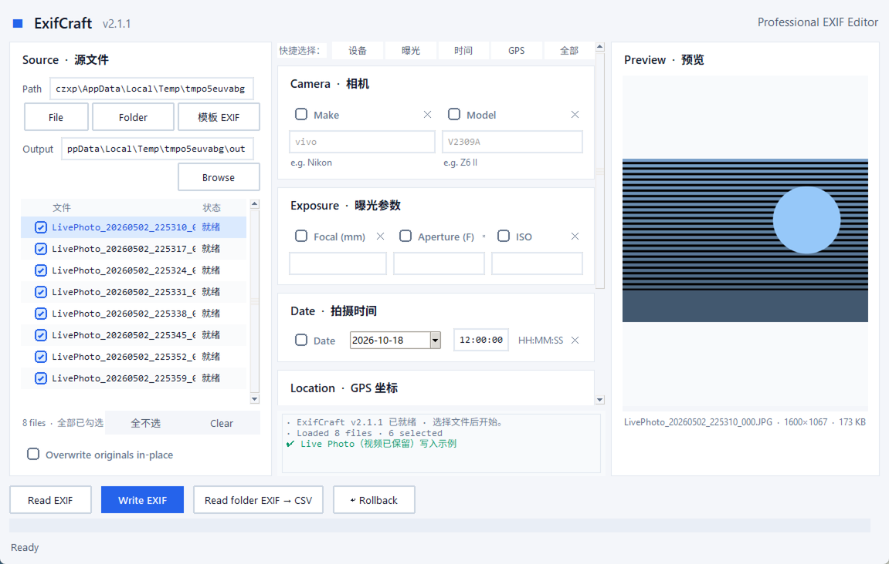

# ExifCraft

**Professional EXIF Editor** — 一个干净、现代的图片元数据（EXIF）读写工具。

ExifCraft 是一个纯 Python 桌面应用，基于 Tkinter 构建，无需浏览器、无需安装大型框架。它可以批量读取和写入图片的 EXIF 元数据，包括 GPS 坐标、相机信息、曝光参数和拍摄时间，并可将整个文件夹的 EXIF 信息导出为 CSV。



## ✨ 功能特性

- **EXIF 写入** — 将 GPS 坐标（经度 / 纬度 / 海拔）、相机制造商与型号、焦距、光圈、ISO、拍摄时间写入 JPEG / TIFF / PNG 等格式图片
- **EXIF 读取** — 选中列表中的文件，一键回填所有字段到表单
- **🖼 缩略图预览** — 选中图片即时预览，显示文件名、真实分辨率与体积，自动纠正拍摄方向（EXIF Orientation）
- **🎯 单项批量编辑** — 每个字段可独立勾选：勾上=写入、点 ✕=清除、不勾=保持原值。可只对整个文件夹改 GPS 而不动拍摄时间；也可一键清除全部 GPS 信息
- **↩ 一键回滚** — 覆盖写入前自动在原目录生成隐藏备份（`._ExifCraft_bak_*.exifbak`），退出前可一键撤销本次所有修改；退出时备份自动清理，不留垃圾文件
- **批量处理** — 支持选择单个文件或整个文件夹，后台线程处理，不阻塞界面，带进度条
- **地图选点**（可选）— 集成 `tkintermapview`，点击地图即可拾取 GPS 坐标
- **日期选择器**（可选）— 集成 `tkcalendar`，日历控件选择拍摄日期
- **CSV 导出** — 一键将文件夹内所有图片的 EXIF 摘要导出为 CSV 表格
- **安全写回** — 默认输出 `*_exif` 副本，不修改原图；也可勾选原地覆盖
- **现代 UI** — 浅色卡片式界面，跨平台 ttk 主题，Windows 下自动启用 HiDPI 适配
- **输入校验** — 经纬度范围、数值格式、日期格式等全部前端校验，错误信息清晰

## 🚀 快速开始

### 环境要求

- Python 3.10+

### 安装依赖

```bash
pip install -r requirements.txt
```

> `PyMuPDF` 为可选依赖，仅用于从 `app_icon.svg` 重新生成图标，运行应用不需要它。

### 运行

```bash
python ExifCraft.pyw
```

> `.pyw` 扩展名表示无控制台窗口运行，直接双击即可启动。

## 📖 使用说明

1. 点击 **File** 选择单张图片，或点击 **Folder** 选择整个文件夹（自动扫描其中的图片）
   - 列表每行前面是勾选框（**■ 已勾选 / □ 未勾选**），**写入只作用于已勾选的文件**
   - 点击某行即切换它的勾选状态并预览该图；也可用空格键切换当前高亮行
   - 列表下方 **全选 / 全不选** 可批量切换；底部会显示 `已勾选 N`
2. 填写右侧表单：
   - **Camera** — 相机制造商（如 Nikon）与型号（如 Z6 II）
   - **Exposure** — 焦距（mm）、光圈（F 值）、ISO
   - **Date** — 拍摄日期与时间（格式 `YYYY:MM:DD HH:MM:SS`）
   - **Location** — 经度（-180 ~ 180）、纬度（-90 ~ 90）、海拔（米）；安装 tkintermapview 后可点击 📍 在地图上选点
3. 点击 **Read EXIF** 可先读取选中文件的现有元数据并回填表单
4. 点击 **Write EXIF** 开始写入：
   - 默认在输出目录生成 `<原文件名>_exif.<扩展名>` 副本（JPEG 以 quality=100 保存）
   - 勾选 *Overwrite originals in-place* 可直接覆盖原图（会自动备份，退出前可回滚）
5. 点击 **Read folder EXIF → CSV** 可将当前文件列表中所有图片的 EXIF 信息导出为 CSV

### 单项批量编辑（只改想改的字段）

右侧每个字段左侧都有勾选框，右侧有 ✕ 按钮，三态含义：

| 状态 | 含义 |
|---|---|
| ☑ 有值 | 写入这个值 |
| ☑ + ✕（框变空） | 删除该字段（清除） |
| ☐ 未勾选 | 保持原文件里的值，**完全不动** |

典型用法：想给整个文件夹统一改拍摄地点，但保留各自原本的拍摄时间 —— 只勾选 Longitude / Latitude 两项，其余全部取消勾选，然后选文件夹、勾选覆盖、点 Write EXIF。时间字段一个字节都不会变。

> 日期行整行由一个勾选框控制。`tkcalendar` 的 DateEntry 没有"空"状态（清空后会自动跳回今天），所以不勾 = 不修改日期。
>
> GPS 卡片底部的 **✕ 清除 GPS 信息** 可整块删除经纬度与海拔，常用于发图前抹掉定位隐私。

### 回滚与备份

- 勾选 *Overwrite originals in-place* 写入时，程序会在**原图所在目录**生成隐藏备份 `._ExifCraft_bak_<会话>_<文件名>.exifbak`
  - 采用重命名（rename）而非复制，即使原图在远程 HDD / NAS 上也几乎瞬间完成
  - 备份文件带隐藏属性且扩展名非图片，不会被相册、刮削器等工具误扫
- 写入过程中可随时点 **↩ Rollback** 撤销本次会话的全部修改
- 退出程序时三选一：**撤销全部修改** / **保留修改并清理备份** / **返回**
- 任何退出路径都会删除备份文件，不会在磁盘上留下占用空间的垃圾
- 若上次异常退出（强杀、断电），下次启动会自动检测并还原中断的写入；残留的孤儿备份会提示是否清理

## 📦 打包发布

支持 PyInstaller 打包为独立可执行文件：

```bash
pyinstaller --onefile --windowed --icon ExifCraft.ico ExifCraft.pyw
```

## 🗂 项目结构

```
ExifCraft/
├── ExifCraft.pyw     # 主程序（单文件应用）
├── ExifCraft.ico     # 应用图标（Windows，多分辨率）
├── preview.png       # 界面预览图
├── requirements.txt  # 依赖清单
└── README.md
```

## 📄 许可证

[MIT](LICENSE) © yohoten
